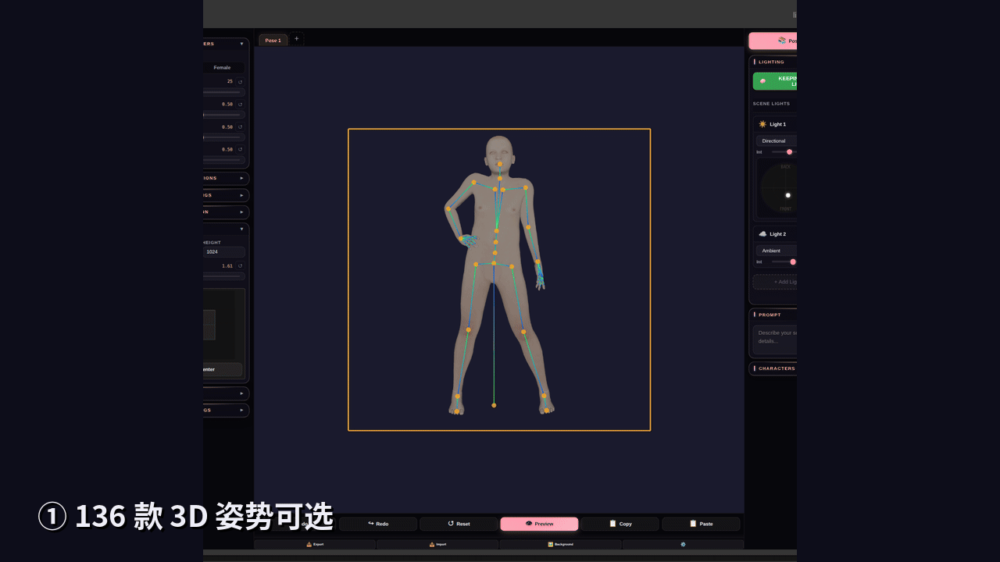
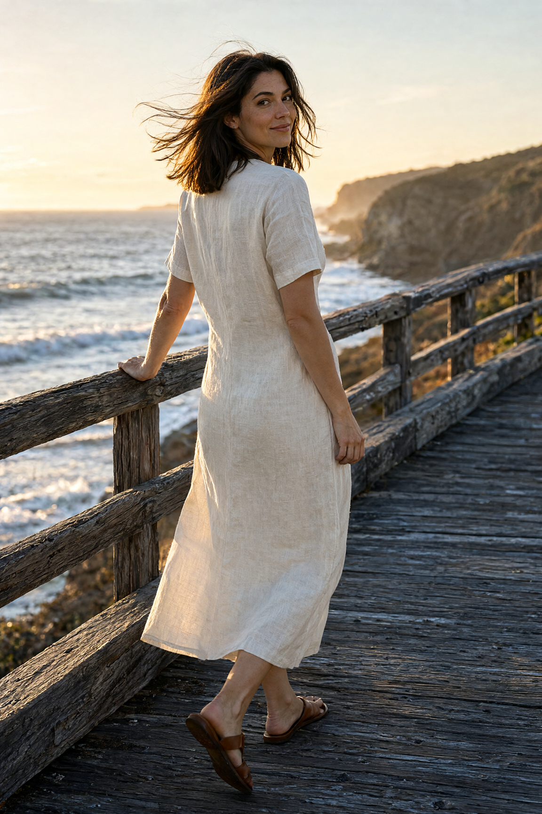
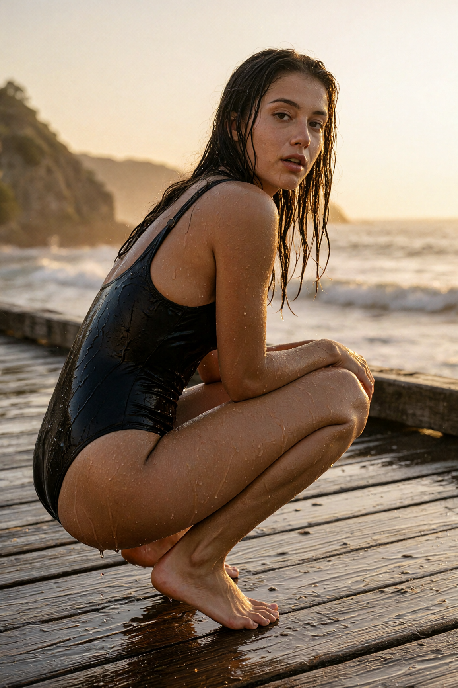
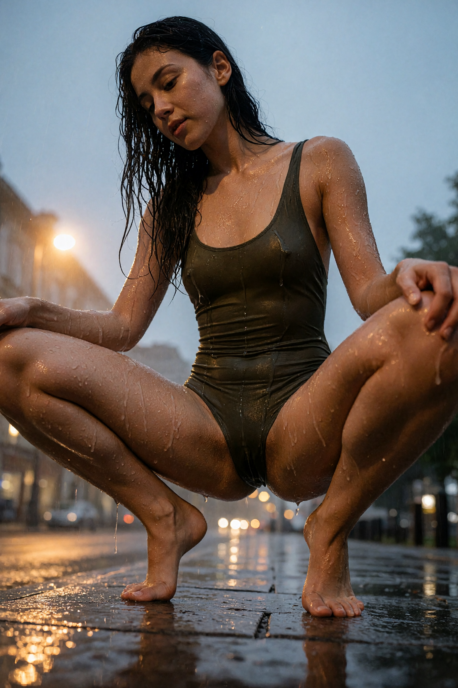
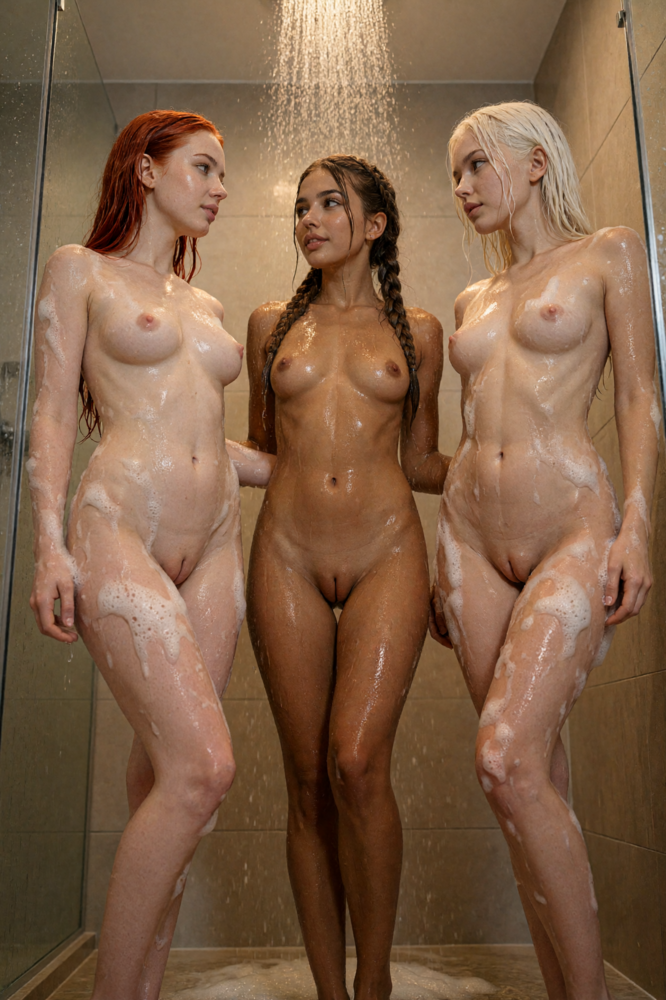
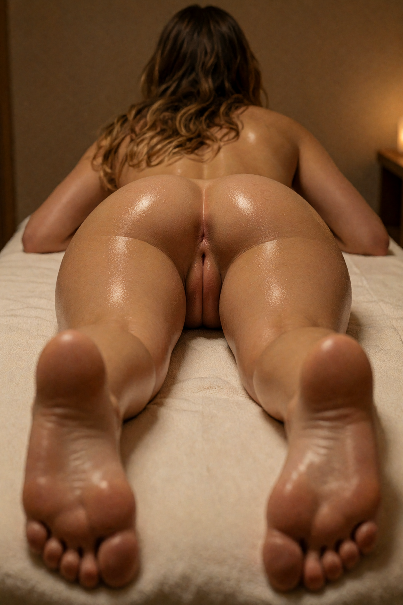
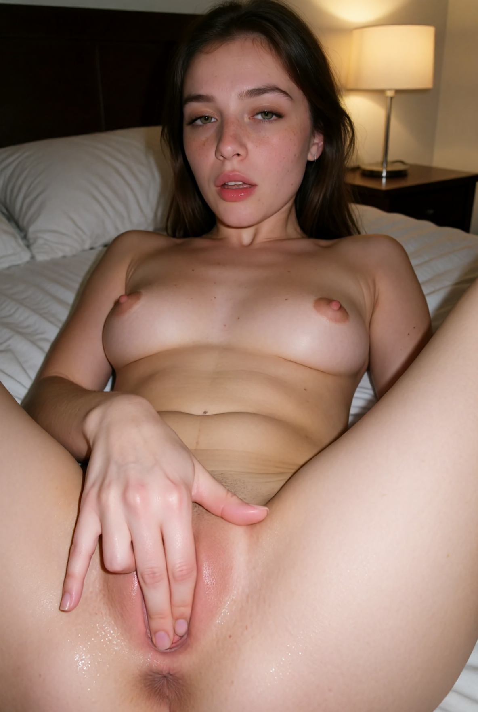

# qwen21-nsfw-pose

[](https://github.com/Arekejoker/qwen21-nsfw-pose-skill/actions/workflows/validate.yml)

English | [中文](README.md)

**A complete local Qwen-Image 2.1 NSFW / pose pipeline** — author-grade prompt structure + NSFW LoRAs + a 136-pose 3D library + precise mannequin pose control with VNCCS.

Built on ComfyUI + the `qwen_image_2.1_int8_convrot` base kit (the same base model the Civitai authors use). The authors' showcase images were reproduced and verified (2026-10-12).

- For: Claude Code / Codex / Cursor / OpenClaw (agent skill) + manual use
- Includes: runnable author cases, the mandatory recipe, boldness tiers (L0–L3), full dependencies and an install guide

**Demo** (deform the 3D mannequin → one-click generate → result, Route ④):



---

## Showcase

### This recipe's output: three tiers of the same seaside scene (L0 → L1 → L2)

| L0 · fully clothed, no LoRA (prompt only) | L1 · wet swimwear + LoRA@1.0 | L2 · very low angle + wet squat + LoRA@1.0 |
| --- | --- | --- |
|  |  |  |

Three images, same scene, escalating: L0 is prompt-only; L1 adds the LoRA plus explicit skin/water-droplet description; L2 adds the low camera angle and an open pose. **The LoRA carries texture, the prompt carries information density, the camera angle carries boldness.**

### NSFW results (⚠️ the images below contain nudity)

<details>
<summary><picture></picture><br/><b>👇 Click the card above to expand the author originals (nudity · 18+, click again to collapse)</b></summary>

**Author originals** (Civitai showcases — what this recipe targets):

| Author · shower (tawsLoRa) | Author · massage (tawsLoRa) | Author · selfie (TheseAlpacas) |
| --- | --- | --- |
|  |  |  |

</details>

The shower image can be reproduced with the command under "Quick start" (the reproduction was verified to match the author original in scene and composition — see `downloads/samples/phase5_meta.json` and the Quick start section below).

### Precise 3D mannequin poses (Route ④, 136-pose library)

Default character image: `references/src_standing.png`. A pose is a skeleton-rotation JSON (MakeHuman mesh, rendered with three.js), so the pose changes while identity is preserved. Pose library sources: four public HuggingFace repos (`Totemistyk/General_Poses`, `Totemistyk/Ballet_PoseStudio`, `MIUProject/VNCCS_PoseLibrary_Main`, `MIUProject/MySuperPoseRepo`) plus 55 hand-picked poses — **136 in total**.

---

## Quick start (follow the author's case)

Install first: see [install/setup.md](install/setup.md). Once installed, run the self-check (read-only, changes nothing):

```bash
python3 scripts/doctor.py
```

It checks ComfyUI connectivity, base models/LoRAs, VNCCS nodes, the pose library and the browser backend item by item, and prints fix instructions for anything missing. When everything is green, one command reproduces the author's shower image (~5 minutes):

```bash
python3 scripts/qwen_pose_test.py \
  --mode t2i --name author_case_shower \
  --prompt "$(cat prompts/taws_v13_shower.txt)" \
  --seed 80964 \
  --steps 50 --cfg 2.5 --sampler er_sde --scheduler beta \
  --width 1152 --height 1728 \
  --lora "qwen2_1-femaledVaginus-nsfw-v1_3-fine_L22-31.safetensors" \
  --lora-strength 1.0 \
  --out outputs/author_case/shower.png
```

Compare against `downloads/samples/taws_v13_shower_author.jpg`.
Full metadata (prompt / parameters / seed / complete workflow): `downloads/samples/phase5_meta.json`.

### Hardware requirements (reference)

The base kit is Qwen-Image 2.1 int8; model files total ~16GB (diffusion 6.8GB / text encoder 8.7GB / VAE 0.6GB), and each LoRA is ≤608MB.

- **Minimum**: NVIDIA 12GB VRAM + 32GB RAM — it runs, but ComfyUI offloads part of the models to system memory and generation is slower
- **Recommended**: 24GB VRAM (3090/4090 class) + 32–64GB RAM — models stay resident and it feels smooth
- **8GB VRAM**: use a GGUF quantized build (the community reports Q4 runs in 12–16GB VRAM; 8GB with offload is noticeably slower)
- Pure CPU is not recommended (a single image takes far too long)
- Reserve ~40GB of disk; no special CPU requirement (any modern x86_64/ARM will do); Linux is the least fuss; on Windows the base scripts (doctor / `--list-poses` / media-lock fallback) run natively (community contribution), while the full pipeline is still best on WSL2; macOS (Apple Silicon) has its own section below
- Route ④ additionally needs a desktop browser you can attach to (Playwright/CDP, see `install/setup.md`)

The showcase images and measurements in this repo come from a unified-memory machine (DGX Spark): 1024×1024, 40 steps, about 32 seconds per image, ~7–10GB peak delta.

### macOS (Apple Silicon)

- For M-series chips (M1 and up); Intel Macs are not recommended
- **Pick the model by unified memory**: ≥32GB, use this repo's original int8 kit directly (ComfyUI + MPS); 16–32GB, prefer a GGUF quantized build (with ComfyUI-GGUF; the community reports Q8 is faster and Q4 saves more memory)
- **Speed expectation: minutes per image** — community reports: M5 Pro 48GB runs int8 at ~144s per 1024px; M1 Max 64GB at ~7–10 minutes per image (cache-optimizing nodes such as Comfyui-Spectrum-Qwen2.1 can speed this up 2–3×). Compare against this repo's measured 32s per image on DGX Spark, for reference only
- Known issue: edit mode occasionally hits a VAE encoding error on MPS — work around it with ComfyUI's `--cpu-vae` (ComfyUI issue #16433, a fix is under discussion); when memory is tight, generate one image at a time and close other memory-hungry apps
- Route compatibility: the ①②③ scripts run directly on macOS (pure Python standard library, POSIX-compatible); ④ needs `playwright install chromium` (the macOS build), and the AppArmor note in `install/setup.md` does not apply
- ⚠️ The Mac figures above come from community reports. The maintainers have no Mac hardware and have not measured them; if you get it running on a Mac, or hit problems, please open an issue and we will keep this section updated

## The four routes

| Goal | Route | Command |
| --- | --- | --- |
| A new NSFW/sexy image from text | ① T2I + NSFW LoRA (mandatory) | `scripts/qwen_pose_test.py --mode t2i` |
| Change the pose of an existing character image (keep face/clothes) | ② Edit | `scripts/qwen_pose_test.py --mode edit` |
| Change pose from a 3D mannequin render (script, no browser) | ③ Scripted pose transfer (mannequin reference + VNCCS LoRA) | `scripts/run_pose_transfer.py --char <character.png> --pose-ref <mannequin_render.png> --out <result.png>` |
| An exact pose from the 3D library | ④ VNCCS PoseStudio | `scripts/run_vnccs_ui.py --pose <name> [--prompt "<scene>"]` |

Route ③'s mannequin reference can be saved automatically by a Route ④ run (the `doll_*.png` files in the output directory), or any 3D pose render.
Do not use a photo or illustration as the pose reference — the model composites the reference person into the frame, or redraws that person entirely; use a textureless 3D mannequin render instead (Routes ③/④).

How to pick a pose (boldness tiers L0–L3, user-request → pose-family mapping): see §4 of `SKILL.md`, or list all 136 poses with
`scripts/run_vnccs_ui.py --list-poses`.

## Recipe highlights (summary)

- `er_sde` + `beta`, CFG 2.5, 50 steps, 1152×1728 portrait
- **The NSFW LoRA is always on** (default `femaledVaginus v1.3b` @ 1.0)
- Prompts must follow the author's structure: all 7 elements, 300–1500 characters, including the LoRA trigger words
- Weakening the recipe (no LoRA / short prompt / fewer steps) requires telling the user the cost first — never weaken it silently

Full rules and evidence: `SKILL.md`.

## Repository layout

```
├── SKILL.md            # the agent skill (complete rules)
├── CHANGELOG.md        # release history
├── install/setup.md    # install guide (models / LoRAs / nodes / pose library)
├── scripts/            # doctor.py self-check, generation & custom-pose scripts, browser fallback, media_lock.py, validate_package.py
├── workflows/          # qwen21_t2i.json / qwen21_edit.json / VNCCS_PoseStudio_QI2.1.json
├── prompts/            # the 3 author prompts + their parameters
├── references/         # showcase images (L0/L1/L2 seaside set) + default character image
├── downloads/samples/  # author originals + author metadata + original workflow JSON
└── pose_library/       # 55 hand-picked poses (copied into ComfyUI at install time)
```

## Notes

- Original code and docs in this repo (`scripts/`, `workflows/`, `prompts/`, `SKILL.md`, README, …) are licensed under the [Apache License 2.0](LICENSE)
- Third-party assets are not covered by Apache-2.0 and remain with their respective authors: the author originals in `downloads/samples/` (Civitai authors), the community poses and previews in `pose_library/` (MIUProject / Totemistyk, of which the Ballet repo is MIT), and the models and LoRAs (HF `Comfy-Org/Qwen-Image-2.1`, Civitai 2986844 / 2958918 / 2988215, RunningHubAI, MIUProject, …)
- The NSFW sample images are for demonstrating the recipe only; this is a public repository, so if that bothers you, star it first and read later

## Acknowledgements

The pose-control capability (Routes ③④) and the 136-pose library build on the open-source work of [AHEKOT](https://github.com/AHEKOT/ComfyUI_VNCCS_Utils) (VNCCS_Utils), [Totemistyk](https://huggingface.co/Totemistyk) and [MIUProject](https://huggingface.co/MIUProject). The base model and LoRAs come from Qwen / Comfy-Org, RunningHubAI, and tawsLoRa, TheseAlpacas and posture-v3 on Civitai. Thanks to all of them.
